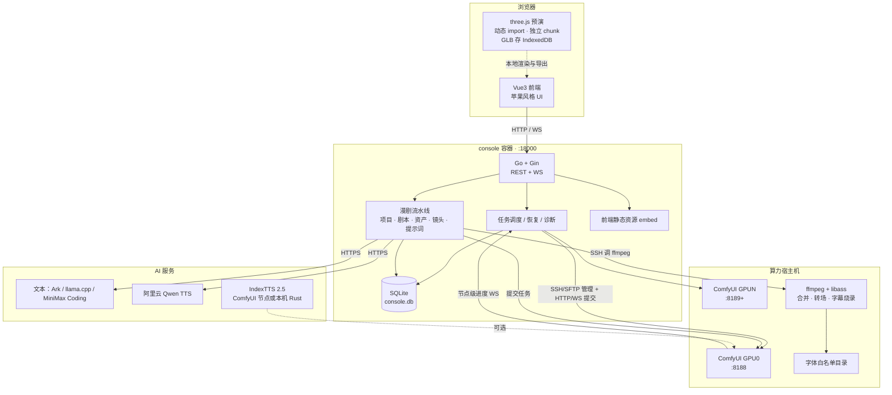

<p align="center">
  <a href="https://hequan2017.github.io/new-aigc-comfyui-minimax-h3/"><strong>🌐 在线静态预览（上游部署）</strong></a>
  ·
  <a href="docs/漫剧工作台新手教程.md"><strong>📘 新手教程</strong></a>
  ·
  <a href="docs/adr/">📐 架构决策记录</a>
</p>

# ComfyStudio · ComfyUI 多卡调度与 AI 漫剧制作平台

[](LICENSE)
[](backend/go.mod)
[](frontend/package.json)
[](THIRD_PARTY_NOTICES.md)

ComfyStudio 是一个 **Go + Vue3** 的单二进制平台：上半部分是 **ComfyUI 多实例调度台**（实例管理、GPU 监控、任务队列与节点级进度），下半部分是 **AI 漫剧制作工作台**（小说/梗概 → 分集剧本 → 角色与视觉资产 → 导演镜头 → 分镜图 → MiniMax H3 视频 → 连续性 → 配音/配乐/字幕 → 终剪成片）。

平台的核心不是“一键黑盒出片”，而是把每一步做成 **可审核、可编辑、可追溯、可恢复** 的人工协作环节：AI 只产出草稿，人工显式确认后才写回；来源（剧本、对白、参考图、模板、提示词）变化后旧产物会显式标记失效，而不是静默沿用。

本 README 按当前代码（`backend/internal/api/router.go`、`frontend/src/views/`、`backend/internal/service/templates/`）重写；界面截图拍摄于较早版本，具体以后运行版本为准。

---

## 目录

- [界面预览](#界面预览)
- [核心特性](#核心特性)
- [功能地图](#功能地图)
- [系统架构](#系统架构)
- [典型工作流](#典型工作流)
- [技术栈](#技术栈)
- [本地开发](#本地开发)
- [部署指南](#部署指南)
- [模型与运行时依赖](#模型与运行时依赖)
- [配置说明](#配置说明)
- [项目结构](#项目结构)
- [API 摘要](#api-摘要)
- [测试与验证](#测试与验证)
- [设计边界与已知限制](#设计边界与已知限制)
- [文档与 ADR](#文档与-adr)
- [开源协议](#开源协议)

---

## 界面预览

<p align="center">
  
  
  <br/>
  
  
  <br/>
  
  
  <br/>
  
</p>

---

## 核心特性

| 能力 | 说明 |
|---|---|
| 多卡调度 | 实例数量可配置（参考部署 8×NVIDIA L40，端口 8188 起）；只从**平台无活动任务且 ComfyUI 队列为空**的实例中挑选，队列短优先、显存多者优先；全忙时任务保持排队而不是判失败 |
| 任务可靠性 | 提交前落库提交尝试、区分“明确拒绝 / 结果未知”、显式 reconcile 与诊断证据、历史丢失时按 prompt ID 兜底；已提交任务拒绝静默重交 |
| MiniMax H3 视频 | 文生视频、图生视频、首尾帧、参考视频（Ref2VA）、单参考、音频驱动（含 T8 增强）、先出视频再封装音轨、武戏专用模板 |
| 分镜与故事版 | H3-Image / Qwen-Image / Krea2 出图；SelfLift 多候选分镜图；铅笔故事版总图（1~15 个因果锚点）；参考图按 `<Picture N>`/`<Subject N>` 顺序绑定 |
| 角色与资产体系 | 结构化角色档案审核、标准像、四视图、独立造型（CharacterLook）、套装（CharacterOutfit）、道具/场景参考图、ERP 全景拆分、顶视结构图、资产变体与对白/共享素材引用 |
| 提示词治理 | 版本化 Skill（系统/自定义 + 项目级启停 + 审计）、项目提示词策略覆盖、阶段产物复用、剧情锚点校验、生成快照与参考图内容哈希 |
| 视频连续性 | 从上一镜末尾抽 22 帧候选，支持原图 / 白模 / 线稿 / 高清（VOSR2）转换，独立、续接、首尾桥接三种模式 |
| 3D 站位预演 | 浏览器内 three.js 懒加载：对象站位、机位、时间轴关键帧、GLB 骨骼动画、天气、白模/深度/序列/WebM 视频导出，可把**选帧绑定到已有 Shot** 并生成可审阅分镜图提示词 |
| 声音制作 | 对白分析（归属/画外/时序）、阿里云 Qwen TTS、IndexTTS 2.5（ComfyUI 节点或显式本机 Rust）、音色预设/复刻/从视频提取参考、配音候选审核与 Scene 连续音轨 |
| 配乐与包装 | Music 3 Cue Sheet（先审核再生成候选，可多次生成不同 seed）、音频层混音（BGM/音效/环境）、非对白屏幕文字（ASS 烧录）、烧录字幕启发式检测、字体商用白名单 |
| 终剪成片 | 剪辑台调整顺序/时长、片段变换与调色、转场、全局视觉轨、叠加素材、音轨混合，SSH 调宿主机 ffmpeg 输出成片与 SRT |

---

## 功能地图

### 1. 平台与实例

- **实例管理**：单实例启动/停止/重启（SSH 调 `start-multi-gpu.sh`）、一键启停、一键重启；实例身份是 `host+port`，因此多台机器可以都使用 8188，`managed=false` 表示只调度不远程启停。
- **GPU 看板**：温度、功耗、显存、利用率与进程采集（`nvidia-smi`），3 秒级刷新。
- **模板**：内置 H3 / H3-Image / Music 3 / Krea2 / MOSS / Qwen-Image 2.1 / VOSR2 / IndexTTS / 人声分离模板，启动时种子化进 SQLite；运行时模板目录可覆盖内置（`POST /api/templates/reload`）。
- **模型目录**：只读的模型能力与模板清单，集中呈现时长、参考图数量与显存风险提示。
- **生成试验场**：与项目无关的生产试验运行（可标星、可提升为素材库条目），不污染正式项目数据。
- **任务中心**：分页筛选、详情、诊断、取消、重排（requeue）、重跑、清空已结束任务；WS 推送节点级进度（生成中封顶 99%）。
- **任务创建**：选择模板与素材，按模板参数定义动态渲染表单（尺寸、时长、步数、种子、CFG、帧率等）。
- **结果服务**：HTTP Range 拖动预览、下载、纯手写 MP4/图片元数据解析（不依赖 ffprobe）。
- **模拟模式**：`simulate: true` 时按模板参考耗时模拟进度，无 GPU 也能走通调度与前端流程。

### 2. 文本、图像与语音模型

| 类别 | 支持 |
|---|---|
| 文生文 | 火山引擎 Ark、本地 llama.cpp（OpenAI 兼容）、MiniMax Coding Plan；统一 `TextProvider` 解析；可选“当前文本模型支持看图”（截图风格提取、首帧润色） |
| 图像生成 | 全部走本地 ComfyUI 引擎：**Krea2**、**MiniMax H3-Image**、**Qwen-Image 2.1**、**MOSS**；按用途选择（场景图默认 H3-Image，四视图与资产默认 MOSS，标准像/换装用 Krea2 或 Qwen） |
| 尾帧增强 | VOSR2 高清放大，白模/线稿为独立模板 |
| 配音 | 阿里云 Qwen TTS（`qwen3-tts-flash` 等）；IndexTTS 2.5 可在 ComfyUI 集群执行，或显式启用本机 Rust 模式（不做失败静默回退） |
| 配乐 | MiniMax Music 3（Cue Sheet 审核通过后显式生成候选，可多次生成不同 seed，人工完整试听后采用） |

> 设置页保留火山 Ark 图生图（Seedream）配置与连通性测试；当前漫剧出图链路由上述 ComfyUI 引擎承担，不依赖该云接口。

### 3. 项目、分集与剧本

- **双入口**：故事梗概创作；TXT/Markdown 长篇小说导入、章节识别、拆分/合并/重排。
- **创作方案**：项目级方案与分集规划，可编辑分集目标；README 不固化默认集数/时长，以界面与 `plan` 接口为准。
- **分集制作**：分集增删改、单集剧本生成/重生成、剧本正文渲染与扩写、脚本版本保存与回滚。
- **剧本导入**：单集剧本预览 → 改编 → 应用；支持导出。
- **对白**：从原文引号抽取对白并保持原字节；可分析说话人、画外音与自然时序；可排除某条对白（不改正文与媒体）。
- **故事与补镜**：按原文整合故事与对白、Scene 正文扩写、在指定 Scene 后插入补镜（草稿带来源哈希，邻居变动后拒绝应用）。
- **锁定与失效**：Scene 可锁定图片/视频防批量覆盖；来源变化使提示词、参考编号与下游产物显式失效。

### 4. 长篇小说改编

- 章节任务与重试、故事弧生成/审核、别名（aliases）审核。
- **Story Bible**：生成、人工编辑、批准、变更提案与逐条审核。
- **滚动分析窗口**：按窗口分析章节、查看进度与上下文、批准/提交/推进，支持绑定生产批次。
- **改编**：改编策略、分集改编生成、批量生成、上下文查看、资产同步与生成、逐集/批量审核、重排预览。
- **规划批次与快照**、故事线索（story clue）转折、用量统计、后台任务（jobs）查询/重试/取消。

### 5. 角色、造型与资产

- **角色档案**：LLM 抽取完整档案 → 人工编辑/批准/驳回/重置；档案变化使下游资产失效；支持预览、参考像提示词、四视图提示词保存。
- **标准像与四视图**：生成或上传；四视图可先上传再补标准像；四视图有独立引擎选择。
- **造型（Look）与套装（Outfit）**：单件服装/鞋履/发型/首饰等资产，组合为套装；审核、发布、图片/四视图、按 Scene 或 Shot 分配。
- **角色语音**：预设音色、自定义音色、上传参考语音复刻；可从 Scene 视频分离人声作为参考草稿（试听确认后才绑定，不是对白识别）。
- **动作参考**：上传复用的动作参考视频（刻意不注入 H3 静态参考槽位）。
- **道具与场景**：参考图生成/上传、四视图（道具）、顶视结构图、ERP 全景图拆分视角、资产变体（生成/上传/收藏/选中/删除）。
- **资产交互设计**：AI 出稿 → 用户给方向 → AI 改稿 → 确认后前端保存；草稿不落库，只保存长期方向与派生关系（派生环会被拒绝）。
- **资产对账**：跨章节资产合并/拆分建议，预览后显式应用。
- **共享素材**：全局素材库 + 项目引用，提供“有效素材”合并视图。
- **人脸遮挡**：场景/道具/共享素材中的无关真实人脸可框选遮挡；正式身份参考（角色/造型/套装）永不遮挡。

### 6. 导演镜头与分镜

- **Shot 层**：幕结构、景别、机位、运镜、时长、动作、情绪、对白与五段导演提示词；单镜时长受模型能力约束。
- **镜头工具**：导演提示词扩写、状态提示词草稿、风格推荐与预设、重定时预览/应用、镜头实体化、原生 Scene 重分组、批量拆分（可暂停/恢复/取消/重试，重启后不会重跑付费调用）。
- **字段级补丁**：`refine-patch` 只允许改可编辑字段；顺序、时长、对白及其时间范围锁定（它们决定 H3 时序与音频），补丁带来源哈希与版本回滚。
- **参考图**：角色/造型/场景/道具有序绑定，服务端统一解析顺序与 `Picture N` 编号；文件缺失/内容变化/来源失效显式标记。
- **分镜图**：H3-Image / Qwen 生成、上传、多候选（SelfLift）、选片与分支；可指定分镜图在视频中的用途（起始帧/指定时间关键帧/结束帧/不使用）。
- **故事版总图**：把 Scene 拆成 1~15 个因果锚点，生成仅供审阅的铅笔总图，不进入生成链。
- **武戏**：项目/场景级 LoRA 有序配置，招式/技能参考检索与展示样例；仅作为导演与提示词上下文。

### 7. MiniMax H3 视频

- 模板协议分离：T2VA / I2VA / FL2VA（关键帧三字段）、Ref2VA（六段）、音频驱动、先出视频再封装音轨、武戏模板。
- 双语提示词：中文主稿 + 英文执行稿；支持“保存中文并翻译英文预览”、人工编辑、显式确认后保存，未保存不自动生成视频。
- **剧情锚点校验**：仅针对 H3 视频提示词的 `P01` 类剧情锚点做校验/修复提示，不混入故事版 `P1：…` 规划流程。
- **提示词失效**：剧情、人物分类、对白、参考图或模板变化后标记旧提示词失效；人工已保存稿优先，阶段复用只产草稿。
- **生成快照**：每次提交记录模板、完整提示词与参考图内容哈希，可对比连续两次输入差异。
- **音频驱动约束**：需要“已接受且与当前 Dialogue 哈希一致”的审核音频候选；不满足时模板不可用并给出原因，不静默降级。

### 8. 连续性与帧处理

- 从上一镜视频末尾抽 22 帧候选，人工选帧或替换。
- 尾帧可作为原图、白模、线稿或高清放大参考；不同参考类型有独立提示词约束（只借姿势/站位/遮挡，不借颜色材质）。
- 连续性模式：独立生成、上一镜续接、上一镜尾帧到当前分镜图的首尾桥接。
- 当前分镜视频可逐帧提取并保存选中帧到项目磁盘，供审核与参考。
- 源视频预览代理与帧精确定位元数据（只读，不改 Scene）。

### 9. 3D 站位预演与选帧

浏览器内客户端渲染，服务端只存与校验：

- 对象站位/尺寸/朝向、机位、命名机位、地面标记、路线与距离。
- 时间轴：对象/机位关键帧、硬切、播放与采样（前后端同一套确定性算法）。
- GLB 骨骼动画：自包含未压缩 GLB（尺寸/顶点/节点/片段/纹理上限，拒绝外部 URI 与必需扩展），AnimationMixer 片段播放与起止/循环参数。
- 天气：晴/阴/雨/雪/雾，仅作预演参数，不自动写入提示词。
- 导出（本地下载）：白模 PNG、8 位线性深度 PNG（近白远黑，范围可调）、1/6/12/24 FPS 序列 ZIP（≤240 帧）、WebM 视频（WebCodecs 按帧序号逐帧编码，VP9/VP8，1280×720，无音轨，≤2880 帧/256MiB，深度视频为有损编码仅供审阅），均带 manifest；不上传、不接深度工作流。
- **两条采用路径**：
  1. 基础站位 → 生成分镜图/视频提示词草稿 → 审阅编辑 → 采用（写入可编辑表单，不自动生成）。
  2. 保存预演 → 在时间轴选帧 → 绑定已有 Shot（不可变历史，含预演 revision、采样时间、帧哈希）→ 生成以该帧为画面目标的 `image_prompt` 草稿 → 人工审阅 → 显式替换当前 Scene 提示词。
- 预演/Scene/Shot 变化、Shot 重排或删除会使旧绑定过期（历史仍可查看），过期绑定不能用于准备提示词。
- GLB 本体仅存浏览器 IndexedDB，服务端不保存模型文件；模型缺失时拒绝导出而不是静默用占位体。

### 10. 配音、配乐、文字与终剪

- **对白与配音**：逐条编辑、试听、重配、回退；对话音频候选（生成/审核/选用）；Scene 连续音轨候选（带 Native Shot 对白范围与音频时间审计）；按集批量合成、批次查询与重试。
- **导出**：单集对白 WAV、分轨 stems、SRT 预览/应用/下载。
- **配乐**：节奏/情绪/乐器/时长要求 → 结构化 Music 3 caption → 审核 → 显式生成候选（可多次生成不同 seed）→ 完整试听审核 → 采用为项目曲目；项目级可复用曲库（5~8 个主题）可放置到时间线。
- **音频层**：BGM、音效、环境声的分段混音；手动 BGM 与 Music 3 区间重叠时按单一优先级规则让位并给出警告。
- **屏幕文字**：人物出场、地点、时间、过场、结束卡；服务端生成 ASS（横/竖排、锚点、颜色、字体、动效），合并时由 ffmpeg 烧录。
- **烧录字幕检测**：ffmpeg 抽帧 + 像素启发式检测底部字幕带；只给时间提示，不改视频；“不确定”必须人工判断。
- **剪辑台**：场景顺序/时长、片段变换（缩放/平移）、速度、亮度/对比度/饱和度、转场（xfade/acrossfade）、叠加素材、全局视觉轨、视觉包装、音轨混合；导出前一致性预检。
- **字体合规**：字体清单校验许可证（商用/再分发/嵌入）、文件 SHA-256 与中文覆盖，未通过不参与渲染。

### 11. Skill、提示词与策略

- 系统/自定义 Skill 版本管理、升级、版本历史、提示词装配预览。
- 项目级 Skill 启停与重置、有效 Skill 查询、审计日志。
- Skill 是受限提示词模板：不具备网络、Shell、文件或数据库执行权限。
- **提示词策略覆盖**：按项目维护图像/视频提示词策略，可查看当前生效来源（系统默认或项目覆盖）。
- **提示词工坊**：构建、优化、翻译、历史与回滚；Qwen-Image 2.1 提示词程序与首帧润色接口。
- **阶段产物**：视频提示词生成、翻译、锚点校验等阶段持久化输入指纹与产物；翻译按分段持久化，失败可只重试失败段；指纹包含参考文件内容哈希。
- 人工已确认/已编辑的提示词优先于阶段草稿与缓存；阶段复用只产生草稿，不自动写回最终提交稿。

### 12. 候选、变体与历史

- 生成候选：保留每次成功任务的不可变输入与产物，可审核、选片、分支、重试、删除；Scene 仍是生成权威。
- 生成媒体库：按族（图片/视频/音频等）浏览、收藏、选用、删除、批量删除。
- 资产变体：生成/上传的新图进入变体列表，显式选中才替换当前参考图（当前图与消费者在此之前不受影响）。
- 脚本版本、生成快照、配音候选与音乐候选都保留历史，便于回溯与 A/B。

### 13. 可恢复性与诊断

- 后台恢复循环扫描卡死任务并 reconcile；`GET /api/tasks/:id` 无副作用，显式 `POST /api/tasks/:id/reconcile` 才查上游。
- 提交响应分类：明确拒绝 → 失败；超时/网关错误/坏响应 → “结果未知”，保留绑定、不自动重交。
- 启动时对“有提交尝试但无 prompt ID”的孤儿任务标记未知，而不是重新提交。
- 取消保守化：只有确认实例队列中已消失才标记已取消；否则记录“取消请求中”，避免误 interrupt 其它任务。
- 任务诊断接口汇总提交证据、恢复状态、提示词与参数摘要，便于定位部署侧问题。

---

## 系统架构



| 组件 | 职责 |
|---|---|
| 浏览器前端 | 漫剧工作台、任务/实例/GPU 看板、素材库、Skill、模型目录、设置；WS 实时刷新；3D 预演与本地导出 |
| console 后端 | 调度、模板渲染、ComfyUI 通信、GPU 监控、实例管理、漫剧流水线、提示词治理、设置（单二进制，前端 embed） |
| SQLite | 任务、模板、项目/分集/场景/镜头、角色/资产、候选/快照、Skill、配乐/文字/音频层、设置 |
| ComfyUI 多实例 | H3 视频、H3-Image、Krea2、MOSS、Qwen-Image 2.1、Music 3、VOSR2、IndexTTS 等模板执行 |
| ffmpeg / libass | 成片 concat、转场、调色、音频混合、SRT/ASS 字幕与屏幕文字烧录 |
| AI 服务 | 文本模型、阿里云 TTS；均为可配置项，不写死在代码 |

---

## 典型工作流


每一步都可单独重做，且默认**不自动触发**下一步；批处理入口存在，但审核、参考图绑定、提示词保存与候选选用都需要显式操作。

---

## 技术栈

| 端 | 技术 |
|---|---|
| 后端 | Go 1.25 · Gin 1.12 · GORM 1.31 · glebarez/sqlite（纯 Go，无 cgo）· gorilla/websocket · pkg/sftp |
| 前端 | Vue 3.5 · Vite 6 · Pinia 2 · Vue Router 4 · three.js 0.180（懒加载）· 无 UI 库 · 黑白主题 |
| 数据库 | SQLite（默认 `/opt/comfyui-console/data/console.db`），启动自动迁移 |
| 推理 | ComfyUI 多实例：MiniMax H3 / H3-Image / Music 3 / Krea2 / MOSS / Qwen-Image 2.1 / VOSR2 / IndexTTS 2.5 |
| AI 服务 | 文本：Ark / llama.cpp / MiniMax Coding Plan；语音：阿里云 Qwen TTS；图像：本地 ComfyUI 引擎 |
| 媒体 | 宿主机 ffmpeg（含 `subtitles` 滤镜，即 libass）+ 合规字体目录 |
| 部署 | 单二进制（前端 embed）· Docker / 裸进程 · GitHub Pages 静态演示 |

---

## 本地开发

```bash
# 1) 后端（默认监听 18000）
cd backend
cp config.yaml.example config.yaml     # 先设 simulate: true 可无 GPU 走通流程
go run .

# 2) 前端（5173，/api 代理到 18000，含 WS）
cd frontend
npm ci
npm run dev
```

- 生产构建会由 Dockerfile 把 `frontend/dist` 放进 `backend/internal/static/dist` 并 embed 进单二进制；本地 `go run .` 使用仓库内已有的 dist 占位。
- `simulate: true` 只模拟任务进度，不调用真实模型；真实出片需要 ComfyUI 实例与对应权重。
- 3D 预演需要浏览器支持 WebGL2 与 IndexedDB；首次导入 GLB 后才会有本地模型记录。

---

## 部署指南

### 部署形态

| 形态 | 说明 | 适用 |
|---|---|---|
| **console 容器 + ComfyUI 宿主机裸进程**（默认） | console 跑 Docker（前端 embed + Go + SQLite）；ComfyUI 由 `start-multi-gpu.sh` 管理；console 经 SSH 启停、经 SFTP 读写素材/结果 | 生产（8×L40 为参考配置） |
| **全容器** | `comfy.mode: docker`，console 经 SSH 在宿主用 `docker compose` 管理 `comfyui-gpu{N}`（CDI 绑卡，共享挂载 models） | 容器化隔离 |
| **本地模式** | `comfy.mode: local`，ComfyUI 与 console 同机裸进程，`remote.host` 留空 | 单机开发 |
| **跨机器实例** | `comfy.instances` 显式列出 `host/port/managed`；适合多台 GPU 机器共用一个控制台 | 异构算力池 |

### 一键部署（Docker）

```bash
git clone https://github.com/hequan2017/new-aigc-comfyui-minimax-h3.git
cd new-aigc-comfyui-minimax-h3
bash deploy.sh            # 更新代码 → 检查环境 → 准备 conda → 构建镜像 → 启动 → 健康检查
bash deploy.sh --no-gpu   # 无 GPU / 未装 nvidia-container-toolkit
bash deploy.sh --rebuild  # 强制重建镜像（发版默认已强制重建）
```

`deploy.sh` 会：拉取代码、清理旧进程/容器、检查 Docker 与 CDI、准备数据目录与 `config.yaml`、增量安装 `comfyui/requirements.txt`、构建并备份镜像、`docker compose up -d`、校验平台 `/api/health` 与各 ComfyUI `/system_stats`，最后写入 `release.json` 发版记录。

部署完成后访问 `http://<服务器IP>:18000`。

### 传统二进制

```bash
cd backend
CGO_ENABLED=0 GOOS=linux GOARCH=amd64 go build -ldflags="-s -w" -o console-linux-amd64 .
scp console-linux-amd64 config.yaml root@<server>:/opt/comfyui-console/
ssh root@<server> "cd /opt/comfyui-console && nohup ./console-linux-amd64 > console.log 2>&1 &"
```

### GitHub Pages 静态预览

`.github/workflows/deploy-pages.yml` 在推送到 `main` 时执行：前端测试 → 构建（`VITE_STATIC_DEMO=true`，Hash 路由 + 自动子路径 base）→ 发布 Pages。静态站没有后端，`/api` 请求无响应，仅用于浏览界面；完整功能需按上文部署。

首次启用需在仓库 **Settings → Actions → General → Workflow permissions** 允许读写（工作流会用 `GITHUB_TOKEN` 开启 Pages），或在 **Settings → Pages** 手动把 Source 设为 GitHub Actions 后重跑。

### 运维

| 操作 | 命令 |
|---|---|
| 升级 | 服务器仓库 `bash deploy.sh` |
| 日志 | `docker logs -f console` |
| 重启平台 | `docker restart console` |
| ComfyUI 实例 | `cd /opt/comfyUI && bash start-multi-gpu.sh {status\|restart\|stop}` |
| 备份 | 备份 `/opt/comfyui-console/data/`（SQLite + 上传素材 + 字体/产物） |
| 镜像缓存 | 构建产物 `docker save` 到 `/opt/docker-images/` |

---

## 模型与运行时依赖

模板会按 `unet_name` / `clip_name` / `vae_name` / `lora_name` 等字段加载权重。**文件名与子目录以 `backend/internal/service/templates/*.json` 为准**；换权重时请同步模板或通过 `extra_model_paths.yaml` 对齐目录，不要只改文档。

| 能力 | 模板/引擎 | 当前模板引用的主要权重（示例） |
|---|---|---|
| H3 视频 | `minimax_h3_t2v` / `i2v` / `first_last` / `ref2v` / `ref2v_single` / `audio_driven_ref2v`（含 `_t8_enhanced`）/ `video_then_audio_mux` / `ref2v_combat` | `minimax-h3/minimax_h3_fl2va_pruned_int8_convrot`、`minimax_h3_ref2va_pruned_int8_convrot`、`qwen3vl_32b_minimax_h3_int8_convrot`、video/audio VAE；可选 `H3_Combat_V2`、`H3_speed_slider_1.1`、`Motion_Repair_V2`、turbo/lightx2v LoRA |
| H3-Image | 场景图、全景图 | `minimax-h3-image/minimax_h3_image_pruned_int8_convrot`、`minimax_h3_image_vae_fp16` |
| Music 3 | `minimax_music_3_episode_segment` | `minimax-music3/minimax_music3_dit_int8_convrot`、`minimax_music3_text_encoder_pruned_int8_convrot`、`MiniMax-Music-3/minimax_music3_dav` |
| Krea2 | 标准像 / 四视图 / 道具四视图 / 分镜参考 | `krea2/Krea2-Moody-Mix-premium_int8_convrot`、`Krea2-四视图QuadView_krea2_v1`、`qwen3vl_4b_fp8_scaled` |
| MOSS | 四视图 / 通用出图 | `moss/moss_image_sft_int8_convrot`、`qwen3.5_9b_int8_convrot`、`flux2-vae` |
| Qwen-Image 2.1 | 文生图 / 多图编辑 | `qwen-image2.1/qwen_image_2.1_int8_convrot`（或 bf16）、`qwen_image_2.1_vae_bf16`、`qwen3vl_8b_int8_convrot` |
| VOSR2 | 尾帧高清放大 | ComfyUI VOSR2 放大节点（模板内模型名 `VOSR2`） |
| IndexTTS 2.5 | 对白合成 | ComfyUI 节点 + 模型目录，或 `native_local` 的 Windows CUDA 发布版（`-tags indextts`） |
| 人声分离 | 角色音色参考提取 | `audio_vocal_separation` 模板 |

宿主环境还需要：

- **ffmpeg**（含 `subtitles` 滤镜/libass）用于成片、字幕与屏幕文字烧录；默认由 console 经 SSH 在算力宿主执行（`local` 模式同机执行）。
- **字体白名单目录**（`manifest.json` + 字体文件；校验许可证、SHA-256 与中文覆盖），可用 `scripts/install-approved-fonts.ps1` 安装。
- **NVIDIA 驱动 + nvidia-container-toolkit**（GPU 监控与容器绑卡）、**conda 环境 `comfyenv`**（ComfyUI 依赖）。

---

## 配置说明

`backend/config.yaml.example` 为模板，复制为 `config.yaml` 后填写真实值（**不要提交含密钥的 config.yaml**）。

| 配置项 | 默认值 | 说明 |
|---|---|---|
| `server.addr` | `0.0.0.0:18000` | 平台监听地址 |
| `combat_reference_dir` | 空 | 武戏招式/技能 GIF 展示目录；留空仍可检索与写作 |
| `comfy.comfy_dir` | `/opt/comfyUI` | ComfyUI 目录 |
| `comfy.base_port` | `8188` | 实例起始端口 |
| `comfy.gpu_count` | `8` | 默认实例数量 |
| `comfy.reserve_vram` | `6` | 每实例预留显存（GB） |
| `comfy.force_fp16` | `true` | 强制 FP16 |
| `comfy.enable_manager` | `true` | 仅 GPU0 启用 ComfyUI Manager |
| `comfy.mode` | `ssh` | `ssh` / `docker` / `local` |
| `comfy.container_prefix` | `comfyui-gpu` | docker 模式容器名前缀 |
| `comfy.network` | `comfyui-console_default` | docker 模式网络 |
| `comfy.output_subfolders` | 空 | 可选：结果恢复时依次尝试的 output 子目录 |
| `comfy.instances` | 空 | 可选：显式跨机实例列表（`gpu_index/host/port/managed`） |
| `storage.db_path` | `/opt/comfyui-console/data/console.db` | SQLite 路径 |
| `storage.data_dir` | `/opt/comfyui-console/data` | 数据目录 |
| `storage.asset_dir` | `data_dir/assets` | 生成素材持久目录（不要指向 ComfyUI input） |
| `gpu.nvidia_smi` | `/usr/bin/nvidia-smi` | nvidia-smi 路径 |
| `gpu.monitor_interval_seconds` | `3` | GPU 采集间隔 |
| `indextts.enabled` | `false` | 是否启用 IndexTTS |
| `indextts.execution_mode` | `comfyui` | `comfyui` / `native_local` / `disabled` |
| `indextts.comfy_source_dir` / `comfy_model_dir` | 空 | ComfyUI 模式下的源码与检查点目录（各实例需一致） |
| `indextts.model_dir` / `dll_path` | 空 | 本机 Rust 模式目录 |
| `indextts.timeout_seconds` | `300` | 合成超时 |
| `remote.host/port/user/password/private_key` | — | SSH 算力节点；私钥优先 |
| `simulate` | `false` | 模拟模式 |

运行时设置（存 SQLite，可在“平台设置”修改）：文本提供方与模型、是否支持看图、图像引擎与画面尺寸、阿里云 TTS 模型、IndexTTS 可用性、**H3 单任务时长上限**（默认 15 秒，4~60 秒，作为执行门禁）、实验性俯视调度、输出子目录等。

相关能力上限（`GET /api/model-capabilities`）：

| 项 | 值 |
|---|---|
| 单 Scene 时长 | 4 ~ 60 秒 |
| H3 单次生成上限 | 默认 15 秒（可调，超过需已实测高显存实例；30 秒以上为高风险） |
| 单 Shot 时长 | ≤ 15 秒；武戏镜 ≤ 6 秒；≥ 10 秒按长镜节奏处理；反应/细节镜可短于常规下限 |
| Scene 参考图 | 最多 9 张 |
| H3 提交参考图 | 最多 8 张（超出按优先级取舍并给出警告） |

---

## 项目结构

```
├── backend/
│   ├── main.go                     # config → db → service → router
│   ├── config.yaml.example
│   ├── internal/
│   │   ├── api/router.go           # 全部路由（权威来源）
│   │   ├── config/                 # 配置加载
│   │   ├── database/               # SQLite 初始化 + AutoMigrate
│   │   ├── models/                 # 任务/项目/场景/镜头/资产/候选/预演等模型
│   │   ├── screenplay/             # 剧本格式解析
│   │   ├── indextts/               # 本机 Rust IndexTTS 绑定
│   │   ├── service/
│   │   │   ├── task_service.go     # 调度、提交、WS 进度、取消/重排
│   │   │   ├── task_recovery.go    # 提交证据、reconcile、启动孤儿恢复
│   │   │   ├── project_service.go  # 漫剧主流水线（剧本/分镜/H3/合并）
│   │   │   ├── scene_reference*.go # 参考图绑定、顺序、失效、人脸遮挡
│   │   │   ├── generation_snapshot.go / preparation_stage.go
│   │   │   ├── scene_previsualization.go / previs_*.go / shot_previs_frame*.go
│   │   │   ├── h3_*.go             # H3 提示词、锚点、翻译、分段
│   │   │   ├── character_*.go      # 档案、造型、套装、音色、动作参考
│   │   │   ├── continuity_*.go     # 尾帧、白模/线稿/高清、桥接
│   │   │   ├── music_*.go / audio_layer_*.go
│   │   │   ├── screen_text_*.go / scene_subtitle_check.go / font_registry.go
│   │   │   ├── merge_audio.go      # 终剪、转场、混音、字幕烧录
│   │   │   ├── novel_* / adaptation_* / analysis_window_* / story_bible_*
│   │   │   ├── skill_service.go / prompt_policy_service.go
│   │   │   ├── text_provider.go / volc_engine.go
│   │   │   ├── comfy_client.go / ws_client.go / instance_manager.go / remote.go
│   │   │   └── templates/          # 内置工作流 JSON（embed，可运行时覆盖）
│   │   └── static/dist             # 前端构建产物（embed）
│   └── deploy.sh
├── comfyui/                        # ComfyUI fork（含 MiniMax H3 实现）
├── frontend/
│   └── src/
│       ├── views/                  # 项目/分集/剪辑/声音/模型/任务/设置等页面
│       ├── components/             # 预演、时间轴、环境、选帧、参考编辑等
│       ├── utils/                  # 预演采样、导出、补丁、时间线等纯函数
│       ├── api/index.js            # REST + WS 客户端
│       └── styles/main.css         # 设计系统（黑白主题）
├── docs/
│   ├── adr/                        # 架构决策记录 0001~0010
│   ├── screenshots/
│   └── *.md                        # 教程、方案、分析与测试说明
├── integrations/                   # comfyui-indextts25 本地/Rust 集成
├── shell/start-multi-gpu.sh        # 宿主机多卡实例启停
├── scripts/                        # 字体安装、Windows IndexTTS 打包、体检脚本
├── Dockerfile / docker-compose*.yml / deploy.sh
└── THIRD_PARTY_NOTICES.md
```

---

## API 摘要

完整路由以 `backend/internal/api/router.go` 为准；下表只列分组代表接口。

| 分组 | 代表接口 |
|---|---|
| 平台 | `GET /api/health`、`GET /api/release`、`GET /api/gpus`、`GET /api/instances`、`POST /api/instances/:id/{start,stop,restart}`、`POST /api/instances/{start,stop,restart}-all` |
| 模板与模型 | `GET /api/templates`、`POST /api/templates/reload`、`GET /api/model-catalog`、`GET /api/model-capabilities` |
| 任务 | `GET/POST /api/tasks`、`GET /api/tasks/:id`、`GET /api/tasks/:id/diagnostics`、`POST /api/tasks/:id/{cancel,requeue,rerun,reconcile}`、`POST /api/tasks/cancel-all` |
| 文件与实时 | `POST /api/upload`、`GET /api/output/:gpu/*path`、`GET /api/media/:gpu/*path`、`GET /api/input/:taskid/*path`、`WS /api/ws` |
| 设置 | `GET/PUT /api/settings`、`POST /api/settings/test-{text,image,tts}`、`GET /api/text-provider/capabilities`、`GET /api/qwen-image-2.1/prompt-programs` |
| 试验场 | `GET/POST /api/playground/runs`、`GET /api/playground/runs/:id`、`POST /api/playground/runs/:id/{star,promote}` |
| 项目 | `GET/POST /api/projects`、`GET/PUT/DELETE /api/projects/:id`、`POST /api/projects/:id/{plan,generate,images,videos}`、`POST /api/projects/:id/generation/reset` |
| 分集 | `GET/POST /api/projects/:id/episodes`、`PATCH/DELETE .../:number`、`GET .../:number/screenplay`、`POST .../screenplay/{preview,adapt,apply}`、`GET .../screenplay/export/:format` |
| 剧本 | `POST /api/projects/:id/script`、`POST .../script/{render,expand}`、`GET/POST .../script-revisions`、`POST .../script-revisions/:rid/restore` |
| 场景 | `PATCH /api/projects/:id/scenes/:sid`、`PATCH .../storyboard-video-role`、`POST .../story/{preview,apply}`、`POST .../dialogue/{analyze,apply}`、`PATCH .../locks` |
| 导演镜头 | `GET/POST .../scenes/:sid/shots`、`PUT /api/projects/:id/shots/:shid`、`POST .../shots/:shid/director-expand`、`POST .../shots/refine-patch[/apply]`、`GET/POST .../shots/{retime,materialize}` |
| 参考图 | `GET/PUT .../scenes/:sid/references`、`GET/PUT/DELETE .../references/face-cover`、`GET .../generation-snapshots`、`GET .../preparation-stages` |
| 分镜图与故事版 | `POST .../scenes/:sid/image`、`POST .../image/upload`、`GET .../candidates`、`POST /api/projects/:id/candidates/:cid/{review,select,branch,retry}`、`POST .../storyboard-sheet[/anchors]` |
| H3 视频 | `POST .../scenes/:sid/video`、`GET .../video/prompt`、`POST .../video/prompt/{regenerate,translate,confirm}`、`PUT .../video/prompt/master`、`POST .../video/{upload,frame-upload,cancel}` |
| 连续性 | `POST .../continuity/frames/extract`、`GET/PUT .../continuity/frames[/select]`、`POST .../frames/:fid/convert`、`GET/PUT .../continuity`、`POST .../frames/extract-all`、`POST .../frames/save` |
| 3D 预演 | `GET/PUT .../scenes/:sid/previsualization`、`POST .../previsualization/plan`、`GET/POST .../previsualization/frames`、`POST .../frames/:fid/prompt/{preview,apply}` |
| 角色 | `GET/POST /api/projects/:id/characters`、`POST .../:cid/portrait[/upload|/reset]`、`POST .../:cid/sheet[/upload]`、`GET/POST .../:cid/profile/*`、`POST .../:cid/voice/*`、`GET/POST .../:cid/motion-references` |
| 造型/套装 | `GET/POST .../:cid/looks`、`POST .../looks/:lid/{prompt,image,approve,reject,publish}`、`GET/POST .../:cid/outfits`、`POST .../outfits/:oid/{image,sheet,approve}` |
| 道具/场景 | `GET/POST /api/projects/:id/assets/:kind`、`POST .../:aid/{image,sheet,topview,panorama}`、`POST .../:kind/design/:step`、`POST .../:aid/panorama/generate` |
| 资产治理 | `POST /api/projects/:id/assets/reconciliation/{preview,apply}`、`GET/POST /api/projects/:id/asset-variants`、`GET/POST .../shared-asset-references`、`GET .../shared-assets/effective` |
| 提示词策略 | `GET/POST /api/projects/:id/prompt-policy-overrides`、`GET .../prompt-policy-effective`、`POST /api/prompts/{build,optimize,translate,rollback}`、`GET /api/prompts/history` |
| Skill | `GET/POST /api/skills`、`GET /api/skills/:id`、`POST .../:id/{preview,upgrade}`、`GET .../history/:code`、`GET/POST /api/projects/:id/skills`、`GET .../skills/audit` |
| 配音 | `GET .../scenes/:sid/dialogues`、`POST .../scenes/:sid/dub`、`POST /api/projects/:id/dub`、`POST .../episodes/:number/dub`、`GET .../dub/batches`、`POST .../dub/{export,stems/export}`、`GET /api/projects/:id/srt` |
| 音乐 | `GET/POST /api/projects/:id/music-cue-sheets`、`POST .../music-cue-sheets/{draft,rewrite,review}`、`POST .../:cid/generate`、`GET .../:cid/candidates`、`POST .../candidates/:mid/{review,select,unselect}` |
| 文字与音频层 | `GET/POST /api/projects/:id/screen-text-cues`、`GET .../screen-text-cues/:cid/render-preview`、`GET .../audio-layers[/preflight]`、`POST .../audio-layers`、`GET /api/fonts` |
| 终剪与合并 | `GET /api/projects/:id/editor`、`PUT .../editor/order`、`PATCH .../scenes/:sid/duration`、`PUT .../editing-draft`、`POST .../scenes/merge/{preview,apply}`、`POST .../{merge,audio-merge,merge-all}`、`POST .../audio-merge/preflight` |
| 素材 | `GET/POST /api/materials`、`DELETE /api/materials/:id` |
| 小说改编 | `POST /api/projects/novel`、`POST /api/projects/:id/novel/upload`、`GET .../novel/chapters`、`POST .../novel/chapters/analyze`、`GET .../novel/arcs`、`GET/PUT/POST .../story-bible`、`GET/POST .../analysis-windows`、`GET .../adaptations`、`POST .../adaptations/{generate,review}` |
| 预设 | `GET /api/presets`、`POST /api/presets/:id/apply`、`POST /api/presets/from-screenshots` |

---

## 测试与验证

提交前建议运行完整检查：

```bash
go -C backend test ./... -count=1
go -C backend build ./...
npm --prefix frontend test        # node --test，无需浏览器
npm --prefix frontend run build
git diff --check
```

覆盖范围（全部使用本地测试桩，不调用真实模型，不产生付费任务）：

- 工作流渲染、素材展开、必填校验、多实例调度与全忙排队。
- 任务提交分类（200/400/坏响应/网关错误/408）、提交前尝试持久化、结果未知不重交、reconcile 幂等、取消不误伤、GET 只读。
- 参考图有序绑定、`Picture N` 编号、内容哈希、失效传播、人脸遮挡坐标。
- 角色档案/造型/套装、资产设计与派生环、全景拆分、资产变体、共享素材。
- H3 各模板协议、对白/旁白/独白、剧情锚点、翻译分段与阶段复用、提示词快照。
- 连续性尾帧、白模/线稿/高清转换、桥接与失效。
- 3D 预演：前后端采样一致性、v1/v2/v3 兼容、时间轴插值与硬切、GLB 校验、白模/深度渲染与 ZIP/CRC、WebM 编码调度与封装结构、选帧绑定的版本/归属/过期/无副作用。
- 声音：对白导出、候选审核、Scene 音轨时间映射、配乐 Cue 与音频层优先级。
- 文字：ASS 样式与锚点、字体合规、字幕检测规则、剪辑台片段效果与 ffmpeg 图构建。
- 前端 `node:test`：预演采样/导出、选帧与绑定、任务恢复文案、时间线与契约测试。

真实模型验收（H3、Music 3、IndexTTS、Krea2/MOSS/Qwen 出图）依赖实际权重与自定义节点，迁移到新机器后应分别做小样本真实生成验证，不能用单元测试代替。

---

## 设计边界与已知限制

- **不自动生成**：站位、3D 预演、故事版、选帧提示词都只产出草稿；写作 `image_prompt` 必须人工审阅并显式采用，视频需要显式点击生成。
- **不静默替换**：参考图、资产变体、GLB 模型、提示词来源变化都会显式标记失效或过期；缺失时拒绝操作而不是用占位内容顶替。
- **3D 预演只在浏览器**：GLB 存 IndexedDB，服务端只保存站位/时间轴/机位等元数据；白模、深度、序列 ZIP、WebM 视频仅本地下载，不上传、不接 ComfyUI 深度控制节点。
- **不猜语义**：不从 GLB 文件名或片段名推断动作语义，不推断服装颜色，不把天气自动写进提示词。
- **字幕检测是启发式**：只抽帧判断底部是否存在变化文字带，结果为“不确定”时必须人工决定；不修改视频。
- **H3 参考图上限 8 张**（Scene 绑定上限 9 张），超限会显示候选数、提交数与取舍优先级；模板切换后旧协议提示词不会自动复用。
- **Seedream 图生图**：设置页保留配置与连通性测试，当前出图链路走本地 ComfyUI 引擎。
- **模板与产出物**：运行时模板目录覆盖内置模板，改 JSON 后需 reload 或重启；`output_workers` 与 `input` 为 ComfyUI 侧目录，不要当作长期备份。
- **ffmpeg 依赖**：字幕、屏幕文字、转场与混音都要求 ffmpeg 支持 `subtitles` 滤镜，并安装白名单字体；缺失时导出预检会报错。默认由 console 经 SSH 在算力宿主执行，`local` 模式下在同机执行。
- **单机 SQLite**：默认单控制台实例，无多租户与细粒度权限。
- **模拟模式**：只验证调度与状态机，不验证真实推理质量。
- **浏览器**：3D 预演需要 WebGL2 + IndexedDB；未做全部浏览器组合的兼容性承诺。

---

## 文档与 ADR

**使用与方案**

- [漫剧工作台新手教程](docs/漫剧工作台新手教程.md)
- [漫剧生成 Skill 详细使用手册](docs/漫剧生成Skill详细使用手册.md)
- [长篇小说改编漫剧详细实施方案](docs/长篇小说改编漫剧-详细实施方案.md)
- [漫剧流水线深度分析](docs/漫剧流水线深度分析.md)、[平台对标分析与优化建议](docs/漫剧平台对标分析与优化建议.md)
- [IndexTTS 2.5 纯 Rust 推理库实施方案](docs/2026-10-02-IndexTTS-2.5纯Rust推理库实施方案.md)
- [视频剪辑统一测试说明](docs/视频剪辑统一测试说明.md)

**架构决策记录（`docs/adr/`）**

| 编号 | 主题 |
|---|---|
| 0001 | 长篇小说分层分析与审核流水线 |
| 0002 | Scene 媒体替换与执行完整性边界 |
| 0003 | 空间关系保留；撤回故事来源与分镜图检查 |
| 0004 | 版本化准备阶段与稳定参考绑定 |
| 0005 | Scene 级轻量 3D 预演旁路 |
| 0006 | 3D 预演直接生成提示词草稿 |
| 0007 | 预演时间轴与受限 agent 计划 |
| 0008 | 预演骨骼动画、天气与白模/深度导出 |
| 0009 | Shot 选帧绑定与可审阅分镜提示词 |
| 0010 | 预演时间轴本地视频导出 |

---

## 开源协议

代码以 [MIT License](LICENSE) 发布，Copyright (c) 2026 hequan2017。

第三方组件、模型概念与许可说明见 [THIRD_PARTY_NOTICES.md](THIRD_PARTY_NOTICES.md)（含 three.js MIT 声明与懒加载包体实测）。模型权重、字体与素材的许可由使用者自行确认；ComfyUI 及其自定义节点遵循各自协议。